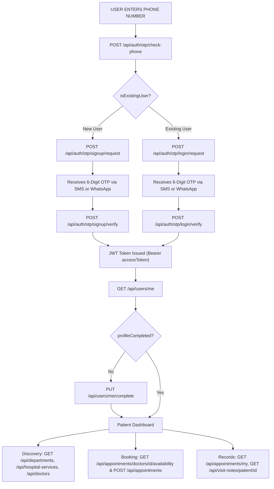

# Hospital API Specification & Complete Frontend User Flow Guide

**Base URL**: `http://localhost:8080` (or your backend host)  
**Standard Authentication Header**: `Authorization: Bearer <accessToken>`

---

## Table of Contents
1. [End-to-End User Journey Overview](#1-end-to-end-user-journey-overview)
2. [Flow A: New User (First-Time Registration & Onboarding)](#2-flow-a-new-user-first-time-registration--onboarding)
3. [Flow B: Returning User (Login & Returning Experience)](#3-flow-b-returning-user-login--returning-experience)
4. [Authentication & OTP Endpoints (`/api/auth/otp`)](#4-authentication--otp-endpoints)
5. [User & Profile Endpoints (`/api/users`)](#5-user--profile-endpoints)
6. [Doctors Endpoints (`/api/doctors`)](#6-doctors-endpoints)
7. [Departments Endpoints (`/api/departments`)](#7-departments-endpoints)
8. [Hospital Services Endpoints (`/api/hospital-services`)](#8-hospital-services-endpoints)
9. [Doctor Schedules Endpoints (`/api/doctor-schedules`)](#9-doctor-schedules-endpoints)
10. [Appointments Endpoints (`/api/appointments`)](#10-appointments-endpoints)
11. [Visit Notes Endpoints (`/api/visit-notes`)](#11-visit-notes-endpoints)
12. [Admin User Management Endpoints (`/api/admin/users`)](#12-admin-user-management-endpoints)
13. [Standard Error Formats](#13-standard-error-formats)

---

## 1. End-to-End User Journey Overview

Modern mobile/web applications can use a unified phone number input screen or separate Login/Register tabs. The backend supports both patterns seamlessly.

### 1.1 Complete Lifecycle Architecture Diagram

```
                      [ USER ENTERS PHONE NUMBER ]
                                    │
                                    ▼
                     POST /api/auth/otp/check-phone
                                    │
                  ┌─────────────────┴─────────────────┐
                  ▼                                   ▼
        [ New User (false) ]               [ Existing User (true) ]
                  │                                   │
                  ▼                                   ▼
      POST /signup/request                POST /login/request
                  │                                   │
            (Receives OTP)                      (Receives OTP)
                  │                                   │
                  ▼                                   ▼
      POST /signup/verify                 POST /login/verify
                  │                                   │
                  └─────────────────┬─────────────────┘
                                    ▼
                         [ JWT Token Issued ]
                 (Authorization: Bearer <accessToken>)
                                    │
                                    ▼
                            GET /api/users/me
                                    │
                  ┌─────────────────┴─────────────────┐
                  ▼                                   ▼
       profileCompleted = false            profileCompleted = true
                  │                                   │
                  ▼                                   │
       PUT /api/users/me/complete                     │
                  │                                   │
                  └─────────────────┬─────────────────┘
                                    ▼
                         [ Patient Dashboard ]
                                    │
        ┌───────────────────────────┼───────────────────────────┐
        ▼                           ▼                           ▼
[ Browse & Search ]       [ Book Appointment ]       [ View Medical Records ]
GET /api/departments      GET /doctors/{id}/avail    GET /api/appointments/my
GET /api/hospital-serv    POST /api/appointments     GET /api/visit-notes/patient/{id}
GET /api/doctors                                     PUT /api/appointments/{id} (Reschedule)
                                                     PATCH /api/appointments/{id}/cancel
```

### 1.2 Interactive Mermaid Workflow Diagram



### 1.3 Step-by-Step Flow Matrix

| Stage | New User Flow | Returning User Flow | Relevant Endpoints |
| :--- | :--- | :--- | :--- |
| **1. Phone Check** | Enters phone number $\rightarrow$ returns `"isExistingUser": false` | Enters phone number $\rightarrow$ returns `"isExistingUser": true` | `POST /api/auth/otp/check-phone` |
| **2. Request Code** | Submits phone, name, email | Submits phone | `POST /signup/request` or `POST /login/request` |
| **3. Verify Code** | Submits phone + 6-digit OTP | Submits phone + 6-digit OTP | `POST /signup/verify` or `POST /login/verify` |
| **4. Authentication** | Receives JWT token, role `PATIENT` | Receives JWT token, role `PATIENT`/`DOCTOR`/`ADMIN` | Returns `AuthResponse` with `accessToken` |
| **5. Profile Status** | Checked via `GET /users/me`; if incomplete, prompt complete | Checked via `GET /users/me`; directly routed to dashboard | `GET /api/users/me` & `PUT /api/users/me/complete` |
| **6. Core Actions** | Browse services, check doctor slots, book first appointment | View upcoming/past appointments, download visit notes, rebook | `/api/appointments/**`, `/api/doctors/**`, `/api/visit-notes/**` |

---

## 2. Flow A: New User (First-Time Registration & Onboarding)

### Step A1: Smart Phone Detection (Optional but Recommended)
When user types their phone number, check if they already have an account:
* **Endpoint**: `POST /api/auth/otp/check-phone`
* **Request**:
```json
{
  "phone": "+919876543210"
}
```
* **Response `200 OK`**:
```json
{
  "phone": "+919876543210",
  "isExistingUser": false,
  "action": "SIGNUP",
  "message": "User does not exist. Proceed to request signup OTP."
}
```
> **Frontend Action**: The frontend detects `"action": "SIGNUP"`. It displays input fields for the user's **Full Name** and optional **Email Address**.

---

### Step A2: Request Registration OTP
The user enters their details and clicks **"Send OTP"**:
* **Endpoint**: `POST /api/auth/otp/signup/request`
* **Request**:
```json
{
  "phone": "+919876543210",
  "name": "Alex Johnson",
  "email": "alex.johnson@example.com"
}
```
* **Response `200 OK`**:
```json
{
  "message": "If signup is available for this number, an OTP has been sent."
}
```
> **Frontend Action**: Start a 60-second resend cooldown timer and navigate to the 6-digit OTP verification screen.

---

### Step A3: Verify Registration OTP & Receive Token
The user enters the 6-digit code received via SMS/WhatsApp:
* **Endpoint**: `POST /api/auth/otp/signup/verify`
* **Request**:
```json
{
  "phone": "+919876543210",
  "otp": "482910"
}
```
* **Response `200 OK`**:
```json
{
  "accessToken": "eyJhbGciOiJIUzI1NiIsInR5cCI6IkpXVCJ9.eyJzdWIiOiIxMiIsIm5hbWUiOiJBbGV4IEpvaG5zb24iLCJyb2xlIjoiUEFUSUVOVCIsImlzcyI6Imhvc3BpdGFsLWFwaSIsImV4cCI6MTcxOTU4MDgwMCwiaWF0IjoxNzE5NTc3MjAwfQ...",
  "tokenType": "Bearer",
  "expiresInSeconds": 3600,
  "userId": 12,
  "name": "Alex Johnson",
  "role": "PATIENT"
}
```
> **Frontend Action**: 
> 1. Save `accessToken`, `userId`, and `role` in `localStorage`, `sessionStorage`, or secure storage.
> 2. Configure HTTP client (Axios, Fetch, Apollo) default header: `Authorization: Bearer <accessToken>`.

---

### Step A4: Check or Finalize User Profile
Verify profile completion:
* **Endpoint**: `GET /api/users/me`
* **Headers**: `Authorization: Bearer <accessToken>`
* **Response `200 OK`**:
```json
{
  "id": 12,
  "name": "Alex Johnson",
  "email": "alex.johnson@example.com",
  "phone": "+919876543210",
  "role": "PATIENT",
  "departmentId": null,
  "departmentName": null,
  "profileCompleted": true,
  "active": true,
  "createdAt": "2026-10-29T10:00:00Z"
}
```
*(If `profileCompleted` is false, frontend prompts user to complete their details via `PUT /api/users/me/complete`).*

---

### Step A5: First Appointment Booking Flow
1. **Browse Doctors by Specialization**:
   * `GET /api/doctors/specialization/Cardiology`
2. **Check Available Dates and Slots**:
   * `GET /api/appointments/doctors/5/availability?date=2026-11-02&timeZone=Asia/Kolkata`
3. **Confirm Booking**:
   * `POST /api/appointments`
   * Request Body:
     ```json
     {
       "doctorId": 5,
       "serviceId": 1,
       "type": "CONSULTATION",
       "preferredAt": "2026-11-02T03:30:00Z",
       "patientTimeZone": "Asia/Kolkata",
       "reason": "Initial heart health evaluation"
     }
     ```
4. **Display Confirmation Screen**: Show confirmed appointment details from the `AppointmentResponse`.

---

## 3. Flow B: Returning User (Login & Returning Experience)

### Step B1: Check Phone / Login Request
User enters their phone number:
* **Endpoint**: `POST /api/auth/otp/check-phone`
* **Request**:
```json
{
  "phone": "+919876543210"
}
```
* **Response `200 OK`**:
```json
{
  "phone": "+919876543210",
  "isExistingUser": true,
  "action": "LOGIN",
  "message": "User exists. Proceed to request login OTP."
}
```
> **Frontend Action**: Frontend directly triggers `POST /api/auth/otp/login/request`:

* **Endpoint**: `POST /api/auth/otp/login/request`
* **Request**:
```json
{
  "phone": "+919876543210"
}
```
* **Response `200 OK`**:
```json
{
  "message": "If login is available for this number, an OTP has been sent."
}
```

---

### Step B2: Verify Login OTP
User enters the OTP received:
* **Endpoint**: `POST /api/auth/otp/login/verify`
* **Request**:
```json
{
  "phone": "+919876543210",
  "otp": "719302"
}
```
* **Response `200 OK`**:
```json
{
  "accessToken": "eyJhbGciOiJIUzI1NiIsInR5cCI6IkpXVCJ9...",
  "tokenType": "Bearer",
  "expiresInSeconds": 3600,
  "userId": 12,
  "name": "Alex Johnson",
  "role": "PATIENT"
}
```
> **Frontend Action**: Store `accessToken`, attach header `Authorization: Bearer <token>`, and redirect to dashboard.

---

### Step B3: Returning User Dashboard Hydration
On app mount, frontend fires parallel requests:
1. **User Profile**: `GET /api/users/me`
2. **Patient's Appointments**: `GET /api/appointments/my`
   * Displays Upcoming Appointments (`status: "CONFIRMED"`)
   * Displays Past Consultations (`status: "COMPLETED"`)
3. **Medical Visit Notes & Prescriptions**:
   * `GET /api/visit-notes/patient/12`
   * Displays doctor consultation summaries, diagnoses, and notes.

---

## 4. Authentication & OTP Endpoints

All authentication endpoints are **Public (no Authorization header required)**.

### 4.1 Check Phone (Smart Routing)
Determines whether a phone number belongs to an existing user or a new user.
* **Method**: `POST`
* **Path**: `/api/auth/otp/check-phone`
* **Request Body**:
```json
{
  "phone": "+919876543210"
}
```
* **Response `200 OK`**:
```json
{
  "phone": "+919876543210",
  "isExistingUser": true,
  "action": "LOGIN",
  "message": "User exists. Proceed to request login OTP."
}
```

---

### 4.2 Request Signup OTP
* **Method**: `POST`
* **Path**: `/api/auth/otp/signup/request`
* **Request Body**:
```json
{
  "phone": "+919876543210",
  "name": "Alex Johnson",
  "email": "alex@example.com"
}
```
* **Response `200 OK`**:
```json
{
  "message": "If signup is available for this number, an OTP has been sent."
}
```

---

### 4.3 Verify Signup OTP
* **Method**: `POST`
* **Path**: `/api/auth/otp/signup/verify`
* **Request Body**:
```json
{
  "phone": "+919876543210",
  "otp": "123456"
}
```
* **Response `200 OK`**:
```json
{
  "accessToken": "eyJhbGciOiJIUzI1NiIsInR5cCI6IkpXVCJ9...",
  "tokenType": "Bearer",
  "expiresInSeconds": 3600,
  "userId": 12,
  "name": "Alex Johnson",
  "role": "PATIENT"
}
```

---

### 4.4 Request Login OTP
* **Method**: `POST`
* **Path**: `/api/auth/otp/login/request`
* **Request Body**:
```json
{
  "phone": "+919876543210"
}
```
* **Response `200 OK`**:
```json
{
  "message": "If login is available for this number, an OTP has been sent."
}
```

---

### 4.5 Verify Login OTP
* **Method**: `POST`
* **Path**: `/api/auth/otp/login/verify`
* **Request Body**:
```json
{
  "phone": "+919876543210",
  "otp": "123456"
}
```
* **Response `200 OK`**:
```json
{
  "accessToken": "eyJhbGciOiJIUzI1NiIsInR5cCI6IkpXVCJ9...",
  "tokenType": "Bearer",
  "expiresInSeconds": 3600,
  "userId": 12,
  "name": "Alex Johnson",
  "role": "PATIENT"
}
```

---

## 5. User & Profile Endpoints

Requires `Authorization: Bearer <token>`.

### 5.1 Get My Profile
* **Method**: `GET`
* **Path**: `/api/users/me`
* **Response `200 OK`**:
```json
{
  "id": 12,
  "name": "Alex Johnson",
  "email": "alex@example.com",
  "phone": "+919876543210",
  "role": "PATIENT",
  "departmentId": null,
  "departmentName": null,
  "profileCompleted": true,
  "active": true,
  "createdAt": "2026-10-29T10:00:00Z"
}
```

---

### 5.2 Update Profile
* **Method**: `PUT`
* **Path**: `/api/users/me`
* **Request Body**:
```json
{
  "name": "Alexander Johnson",
  "email": "alexander.johnson@example.com"
}
```
* **Response `200 OK`**: Updated user object.

---

### 5.3 Complete Profile
* **Method**: `PUT`
* **Path**: `/api/users/me/complete`
* **Request Body**:
```json
{
  "name": "Alexander Johnson",
  "email": "alexander.johnson@example.com",
  "phone": "+919876543210"
}
```
* **Response `200 OK`**: Updated user object with `profileCompleted: true`.

---

## 6. Doctors Endpoints

Public access for read operations; modifications require staff roles.

### 6.1 List / Search Doctors
* **Method**: `GET`
* **Path**: `/api/doctors`
* **Query Parameters** (optional):
  * `name`: string (e.g. `?name=Chen`)
  * `specialization`: string (e.g. `?specialization=Cardiology`)
* **Response `200 OK`**:
```json
[
  {
    "id": 1,
    "name": "Dr. Sarah Jenkins",
    "specialization": "Cardiology",
    "qualification": "MBBS, MD (Cardiology)",
    "experience": 12,
    "department_id": 2,
    "department_name": "CARDIOLOGY",
    "user_id": 5,
    "user_name": "Dr. Sarah Jenkins",
    "user_phone": "+919811122233",
    "user_email": "sarah.jenkins@hospital.com"
  }
]
```

---

### 6.2 Get Doctor by ID
* **Method**: `GET`
* **Path**: `/api/doctors/{id}`
* **Response `200 OK`**: Single doctor object.

---

### 6.3 Get Doctors by Name Substring
* **Method**: `GET`
* **Path**: `/api/doctors/name/{name}`
* **Response `200 OK`**: Array of matching doctor objects.

---

### 6.4 Get Doctors by Specialization
* **Method**: `GET`
* **Path**: `/api/doctors/specialization/{specialization}`
* **Response `200 OK`**: Array of matching doctor objects.

---

### 6.5 Create Doctor Profile
* **Method**: `POST`
* **Path**: `/api/doctors`
* **Access**: `ADMIN`, `RECEPTION`
* **Request Body**:
```json
{
  "name": "Dr. Robert Chen",
  "specialization": "Neurology",
  "qualification": "MBBS, DM (Neurology)",
  "experience": 8,
  "departmentId": 3,
  "userId": 6
}
```
* **Response `201 Created`**: Created doctor object.

---

### 6.6 Update Doctor Profile
* **Method**: `PUT`
* **Path**: `/api/doctors/{id}`
* **Access**: `ADMIN`, `RECEPTION`
* **Request Body**:
```json
{
  "name": "Dr. Robert Chen",
  "specialization": "Neurology & Neurosurgery",
  "qualification": "MBBS, DM (Neurology), Fellowship",
  "experience": 9,
  "departmentId": 3
}
```
* **Response `200 OK`**: Updated doctor object.

---

### 6.7 Delete Doctor Profile
* **Method**: `DELETE`
* **Path**: `/api/doctors/{id}`
* **Access**: `ADMIN`
* **Response**: `204 No Content`

---

## 7. Departments Endpoints

### 7.1 List Departments
* **Method**: `GET`
* **Path**: `/api/departments`
* **Query Parameters**: `activeOnly=true` (optional, default `false`)
* **Access**: Public
* **Response `200 OK`**:
```json
[
  {
    "id": 1,
    "name": "CARDIOLOGY",
    "description": "Comprehensive cardiac diagnostics and treatment",
    "imageUrl": "https://example.com/cardiology.jpg",
    "active": true
  }
]
```

---

### 7.2 Get Department by ID
* **Method**: `GET`
* **Path**: `/api/departments/{id}`
* **Access**: Public
* **Response `200 OK`**: Single department object.

---

### 7.3 Create Department
* **Method**: `POST`
* **Path**: `/api/departments`
* **Access**: `ADMIN`, `RECEPTION`
* **Request Body**:
```json
{
  "name": "CARDIOLOGY",
  "description": "Comprehensive cardiac diagnostics and treatment",
  "imageUrl": "https://example.com/cardiology.jpg"
}
```
* **Response `201 Created`**: Created department object.

---

### 7.4 Update Department
* **Method**: `PUT`
* **Path**: `/api/departments/{id}`
* **Access**: `ADMIN`, `RECEPTION`
* **Request Body**: (Same structure as Create)
* **Response `200 OK`**: Updated department object.

---

### 7.5 Toggle Department Status
* **Method**: `PATCH`
* **Path**: `/api/departments/{id}/status?active=false`
* **Access**: `ADMIN`, `RECEPTION`
* **Response `200 OK`**: Updated department object.

---

### 7.6 Delete Department
* **Method**: `DELETE`
* **Path**: `/api/departments/{id}`
* **Access**: `ADMIN`
* **Response**: `204 No Content`

---

## 8. Hospital Services Endpoints

### 8.1 List Services
* **Method**: `GET`
* **Path**: `/api/hospital-services`
* **Query Parameters** (optional):
  * `type`: enum (`CONSULTATION`, `LAB_TEST`, `IMAGING`, `PROCEDURE`)
  * `departmentId`: number
  * `activeOnly`: boolean (default `true`)
* **Access**: Public
* **Response `200 OK`**:
```json
[
  {
    "id": 1,
    "name": "General Cardiology Consultation",
    "type": "CONSULTATION",
    "description": "Initial cardiac check and ECG review",
    "price": 1200.00,
    "departmentId": 1,
    "departmentName": "CARDIOLOGY",
    "active": true
  }
]
```

---

### 8.2 Get Service by ID
* **Method**: `GET`
* **Path**: `/api/hospital-services/{id}`
* **Access**: Public
* **Response `200 OK`**: Single service object.

---

### 8.3 Create Service
* **Method**: `POST`
* **Path**: `/api/hospital-services`
* **Access**: `ADMIN`, `RECEPTION`
* **Request Body**:
```json
{
  "name": "Echocardiogram (ECHO)",
  "type": "IMAGING",
  "description": "2D Doppler ECHO imaging",
  "price": 2500.00,
  "departmentId": 1
}
```
* **Response `201 Created`**: Service object.

---

### 8.4 Update Service
* **Method**: `PUT`
* **Path**: `/api/hospital-services/{id}`
* **Access**: `ADMIN`, `RECEPTION`
* **Request Body**: (Same structure as Create)
* **Response `200 OK`**: Updated service object.

---

### 8.5 Toggle Service Status
* **Method**: `PATCH`
* **Path**: `/api/hospital-services/{id}/status?active=false`
* **Access**: `ADMIN`, `RECEPTION`
* **Response `200 OK`**: Updated service object.

---

### 8.6 Delete Service
* **Method**: `DELETE`
* **Path**: `/api/hospital-services/{id}`
* **Access**: `ADMIN`
* **Response**: `204 No Content`

---

## 9. Doctor Schedules Endpoints

Requires `Authorization: Bearer <token>`.

### 9.1 Create Schedule
* **Method**: `POST`
* **Path**: `/api/doctor-schedules`
* **Access**: `ADMIN`, `RECEPTION`
* **Request Body**:
```json
{
  "doctorId": 5,
  "dayOfWeek": "MONDAY",
  "startTime": "09:00:00",
  "endTime": "13:00:00",
  "validFrom": "2026-11-01",
  "validUntil": null,
  "blockedDates": ["2026-12-25"],
  "leaveDates": ["2026-11-15"]
}
```
* **Response `201 Created`**:
```json
{
  "id": 1,
  "doctorId": 5,
  "doctorName": "Dr. Sarah Jenkins",
  "dayOfWeek": "MONDAY",
  "startTime": "09:00:00",
  "endTime": "13:00:00",
  "validFrom": "2026-11-01",
  "validUntil": null,
  "blockedDates": ["2026-12-25"],
  "leaveDates": ["2026-11-15"],
  "active": true,
  "createdAt": "2026-10-29T10:00:00Z",
  "updatedAt": "2026-10-29T10:00:00Z"
}
```

---

### 9.2 Get Schedules for a Doctor
* **Method**: `GET`
* **Path**: `/api/doctor-schedules/doctor/{doctorId}`
* **Access**: Authenticated
* **Response `200 OK`**: Array of schedule objects.

---

### 9.3 Update Schedule
* **Method**: `PUT`
* **Path**: `/api/doctor-schedules/{id}`
* **Access**: `ADMIN`, `RECEPTION`
* **Request Body**:
```json
{
  "dayOfWeek": "MONDAY",
  "startTime": "09:30:00",
  "endTime": "13:30:00",
  "validFrom": "2026-11-01",
  "validUntil": null,
  "blockedDates": [],
  "leaveDates": []
}
```
* **Response `200 OK`**: Updated schedule object.

---

### 9.4 Delete Schedule
* **Method**: `DELETE`
* **Path**: `/api/doctor-schedules/{id}`
* **Access**: `ADMIN`, `RECEPTION`
* **Response**: `204 No Content`

---

## 10. Appointments Endpoints

Requires `Authorization: Bearer <token>`.

### 10.1 Check Available Slots (Crucial for Booking UI)
Returns available 15-minute booking slots considering doctor schedules, leave dates, cooldown windows, and existing bookings.
* **Method**: `GET`
* **Path**: `/api/appointments/doctors/{doctorId}/availability`
* **Query Parameters**:
  * `date`: `YYYY-MM-DD` (required, e.g. `2026-11-02`)
  * `timeZone`: string (optional, default `Asia/Kolkata`)
* **Access**: `PATIENT`
* **Response `200 OK`**:
```json
{
  "doctorId": 5,
  "doctorName": "Dr. Sarah Jenkins",
  "date": "2026-11-02",
  "timeZone": "Asia/Kolkata",
  "availableSlots": [
    {
      "startAt": "2026-11-02T03:30:00Z",
      "endAt": "2026-11-02T03:45:00Z",
      "localStartTime": "09:00:00",
      "localEndTime": "09:15:00"
    },
    {
      "startAt": "2026-11-02T04:00:00Z",
      "endAt": "2026-11-02T04:15:00Z",
      "localStartTime": "09:30:00",
      "localEndTime": "09:45:00"
    }
  ]
}
```

---

### 10.2 Book an Appointment
* **Method**: `POST`
* **Path**: `/api/appointments`
* **Access**: `PATIENT`
* **Request Body**:
```json
{
  "doctorId": 5,
  "serviceId": 1,
  "type": "CONSULTATION",
  "preferredAt": "2026-11-02T03:30:00Z",
  "patientTimeZone": "Asia/Kolkata",
  "reason": "Chest tightness and palpitations",
  "collectionType": null,
  "collectionAddress": null
}
```
* **Response `201 Created`**:
```json
{
  "id": 101,
  "patientId": 12,
  "patientName": "Alex Johnson",
  "doctorId": 5,
  "doctorName": "Dr. Sarah Jenkins",
  "serviceId": 1,
  "serviceName": "General Cardiology Consultation",
  "type": "CONSULTATION",
  "preferredAt": "2026-11-02T03:30:00Z",
  "startAt": "2026-11-02T03:30:00Z",
  "endAt": "2026-11-02T03:45:00Z",
  "patientTimeZone": "Asia/Kolkata",
  "status": "CONFIRMED",
  "reason": "Chest tightness and palpitations",
  "collectionType": null,
  "collectionAddress": null,
  "cancellationReason": null,
  "createdAt": "2026-10-29T11:00:00Z",
  "updatedAt": "2026-10-29T11:00:00Z"
}
```

---

### 10.3 Get Patient's Appointments
* **Method**: `GET`
* **Path**: `/api/appointments/my`
* **Access**: `PATIENT`
* **Response `200 OK`**: Array of appointment objects.

---

### 10.4 Get Doctor's Appointments
* **Method**: `GET`
* **Path**: `/api/appointments/doctor/my`
* **Access**: `DOCTOR`
* **Response `200 OK`**: Array of appointments assigned to the logged-in doctor.

---

### 10.5 List Hospital Appointments (Staff)
* **Method**: `GET`
* **Path**: `/api/appointments`
* **Query Parameters** (optional): `status=CONFIRMED` (`CONFIRMED`, `CANCELLED`, `COMPLETED`)
* **Access**: `ADMIN`, `RECEPTION`
* **Response `200 OK`**: Array of appointment objects across the hospital.

---

### 10.6 Get Appointment by ID
* **Method**: `GET`
* **Path**: `/api/appointments/{id}`
* **Access**: Patient Owner, Assigned Doctor, `ADMIN`, `RECEPTION`
* **Response `200 OK`**: Single appointment object.

---

### 10.7 Update / Reschedule Appointment
* **Method**: `PUT`
* **Path**: `/api/appointments/{id}`
* **Access**: Patient Owner, `ADMIN`, `RECEPTION`
* **Request Body**:
```json
{
  "preferredAt": "2026-11-02T04:00:00Z",
  "type": "CONSULTATION",
  "serviceId": 1,
  "reason": "Rescheduling due to traffic"
}
```
* **Response `200 OK`**: Updated appointment object.

---

### 10.8 Update Appointment Status (e.g., Complete Consultation)
* **Method**: `PATCH`
* **Path**: `/api/appointments/{id}/status`
* **Access**: Assigned Doctor, `ADMIN`, `RECEPTION`
* **Request Body**:
```json
{
  "status": "COMPLETED",
  "cancellationReason": null
}
```
* **Response `200 OK`**: Updated appointment object with new status.

---

### 10.9 Cancel Appointment
* **Method**: `PATCH`
* **Path**: `/api/appointments/{id}/cancel?reason=Unable+to+attend`
* **Access**: Patient Owner, `ADMIN`, `RECEPTION`
* **Response `200 OK`**: Appointment object with `status: "CANCELLED"`.

---

### 10.10 Delete Appointment
* **Method**: `DELETE`
* **Path**: `/api/appointments/{id}`
* **Access**: `ADMIN`
* **Response**: `204 No Content`

---

## 11. Visit Notes Endpoints

Requires `Authorization: Bearer <token>`.

### 11.1 Create Visit Note
* **Method**: `POST`
* **Path**: `/api/visit-notes`
* **Access**: `DOCTOR` (assigned to the appointment)
* **Request Body**:
```json
{
  "appointmentId": 101,
  "notes": "Patient examined. Resting heart rate 78 bpm. Advised lifestyle modifications and prescribed medication."
}
```
* **Response `201 Created`**:
```json
{
  "id": 1,
  "patientId": 12,
  "patientName": "Alex Johnson",
  "doctorId": 5,
  "doctorName": "Dr. Sarah Jenkins",
  "appointmentId": 101,
  "notes": "Patient examined...",
  "createdAt": "2026-11-02T04:15:00Z",
  "updatedAt": "2026-11-02T04:15:00Z"
}
```

---

### 11.2 Get Visit Note by ID
* **Method**: `GET`
* **Path**: `/api/visit-notes/{id}`
* **Access**: Patient Owner, Author Doctor, `ADMIN`
* **Response `200 OK`**: Single visit note object.

---

### 11.3 Get Patient's Visit Notes (Medical History)
* **Method**: `GET`
* **Path**: `/api/visit-notes/patient/{patientId}`
* **Access**: That Patient, Author Doctors, `ADMIN`
* **Response `200 OK`**: Array of visit notes for the patient.

---

### 11.4 Get Doctor's Own Visit Notes
* **Method**: `GET`
* **Path**: `/api/visit-notes/my`
* **Access**: `DOCTOR`
* **Response `200 OK`**: Array of visit notes authored by the logged-in doctor.

---

### 11.5 Update Visit Note
* **Method**: `PUT`
* **Path**: `/api/visit-notes/{id}`
* **Access**: Author Doctor
* **Request Body**:
```json
{
  "notes": "Updated dosage instructions: Take Atenolol with food."
}
```
* **Response `200 OK`**: Updated visit note object.

---

### 11.6 Delete Visit Note
* **Method**: `DELETE`
* **Path**: `/api/visit-notes/{id}`
* **Access**: Author Doctor
* **Response**: `204 No Content`

---

## 12. Admin User Management Endpoints

Requires `Authorization: Bearer <token>` with `role: "ADMIN"`.

### 12.1 Create Staff / Doctor Account
* **Method**: `POST`
* **Path**: `/api/admin/users`
* **Request Body**:
```json
{
  "name": "Dr. Robert Chen",
  "phone": "+919811122233",
  "email": "robert.chen@hospital.com",
  "role": "DOCTOR",
  "departmentId": 3
}
```
* **Response `201 Created`**: Created user object.

---

### 12.2 List All Users
* **Method**: `GET`
* **Path**: `/api/admin/users`
* **Response `200 OK`**: Array of user objects.

---

### 12.3 Get User by ID
* **Method**: `GET`
* **Path**: `/api/admin/users/{id}`
* **Response `200 OK`**: Single user object.

---

### 12.4 Update User
* **Method**: `PUT`
* **Path**: `/api/admin/users/{id}`
* **Request Body**:
```json
{
  "name": "Dr. Robert Chen",
  "email": "robert.chen@hospital.com",
  "phone": "+919811122233",
  "role": "DOCTOR",
  "departmentId": 3,
  "active": true
}
```
* **Response `200 OK`**: Updated user object.

---

### 12.5 Toggle User Status
* **Method**: `PATCH`
* **Path**: `/api/admin/users/{id}/status?active=false`
* **Response `200 OK`**: Updated user object.

---

### 12.6 Delete User
* **Method**: `DELETE`
* **Path**: `/api/admin/users/{id}`
* **Response**: `204 No Content`

---

## 13. Standard Error Formats

### 13.1 Validation Failure (`400 Bad Request`)
```json
{
  "timestamp": "2026-10-29T10:00:00.123Z",
  "status": 400,
  "error": "Validation failed",
  "fieldErrors": {
    "phone": "Phone number is required",
    "name": "Doctor name is required"
  }
}
```

### 13.2 Resource Not Found (`404 Not Found`)
```json
{
  "timestamp": "2026-10-29T10:00:00.123Z",
  "status": 404,
  "error": "Doctor not found with id: 99"
}
```

### 13.3 Conflict / Duplicate (`409 Conflict`)
```json
{
  "timestamp": "2026-10-29T10:00:00.123Z",
  "status": 409,
  "error": "Phone number is already registered"
}
```

### 13.4 Unauthorized / Forbidden (`401` / `403`)
```json
{
  "timestamp": "2026-10-29T10:00:00.123Z",
  "status": 403,
  "error": "Access denied: insufficient permissions"
}
```
